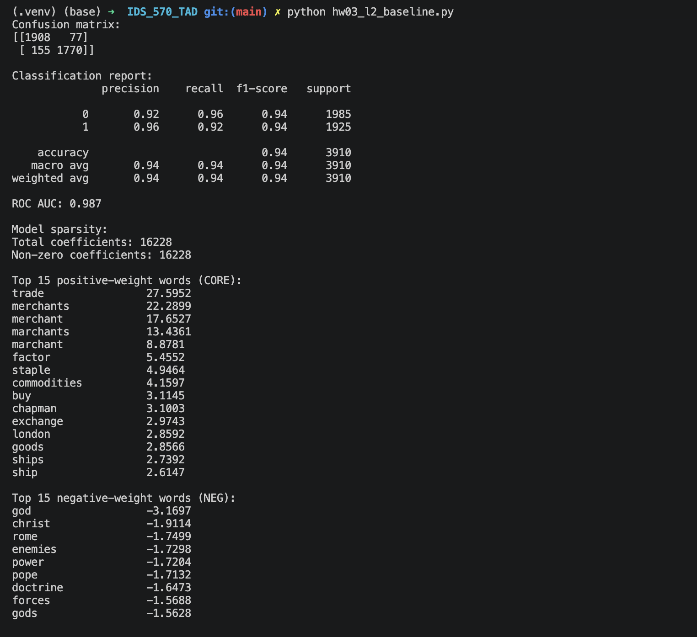
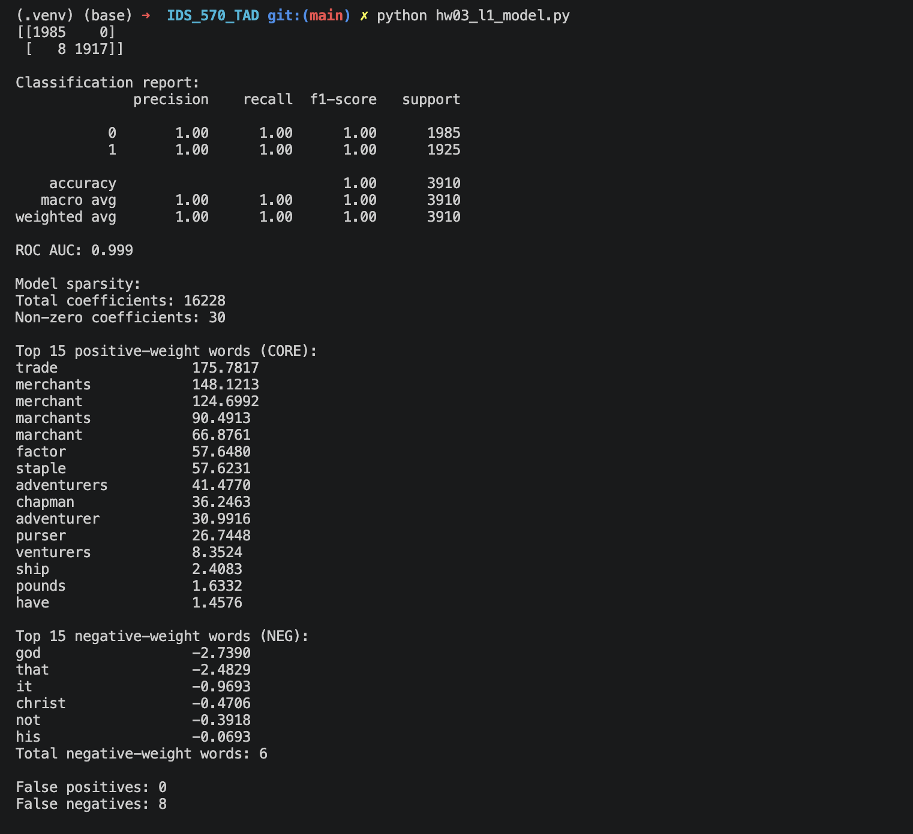

# L1 vs. L2 Regularized Logistic Regression

## Project Overview

This project compares L1- and L2-regularized logistic regression classifiers for identifying merchant-related discourse in historical texts.

The models use TF–IDF features and the same training and testing datasets generated through the Week 8–9 weak-supervision tutorial.

The objective is to evaluate differences in classification performance, coefficient sparsity, and interpretability.

## Methodology

- **Dataset:** Historical text corpus, processed into labeled text chunks.
- **Classification:** Binary classification (CORE = 1, NEG = 0).
- **Features:** TF–IDF with `lowercase=True`, `min_df=5`, and `max_df=0.9`.
- **Baseline:** Logistic regression with default L2 regularization.
- **Comparison:** Logistic regression with L1 regularization using the `liblinear` solver.
- **Evaluation:** Confusion matrix, precision, recall, F1-score, ROC AUC, and coefficient sparsity.

Both models use identical saved training and testing splits.

## Results

| Metric | L2 Baseline | L1 Model |
|---|---:|---:|
| Test accuracy | 94.07% | 99.80% |
| CORE F1-score | 0.94 | 1.00 |
| ROC AUC | 0.987 | 0.999 |
| Misclassified observations | 232 | 8 |
| Total coefficients | 16,228 | 16,228 |
| Non-zero coefficients | 16,228 | 30 |

L1 regularization eliminated approximately 99.82% of the model coefficients while achieving higher test-set performance.

## Interpretability

Both models identified merchant-related terms such as *trade*, *merchants*, *merchant*, and *marchants* as strong positive predictors.

The L2 model assigned weights to a broad range of vocabulary, while L1 concentrated its predictive information on 30 active features.

The exceptionally high L1 performance should be interpreted cautiously because the original labels were generated through keyword-based weak supervision.

## Model Outputs

### L2 Baseline

### L1 Model

## Reproducing the Analysis

The scripts require Python, NumPy, and scikit-learn.

The following datasets must be generated using the IDS 570 Week 8–9 tutorial and placed inside a `data/` directory:

- `train_core_vs_neg.json`
- `test_core_vs_neg.json`

Run the baseline using `python hw03_l2_baseline.py`.

Run the L1 model using `python hw03_l1_model.py`.

**Note:** The original historical text corpus, generated datasets, and trained Word2Vec model are excluded from this repository to avoid uploading large data files.

## Files

- `hw03_l2_baseline.py` — Baseline logistic regression classifier using L2 regularization.
- `hw03_l1_model.py` — L1-regularized classifier and interpretability diagnostics.
- `screenshots/` — Terminal output documenting model evaluations.

## Conclusion

L1 regularization produced a considerably sparser and more interpretable classifier while improving agreement with weakly supervised labels. Nevertheless, examining misclassified historical passages remains important for determining whether the extracted features represent meaningful merchant discourse rather than simply reproducing keyword-based labeling rules.